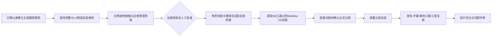

# 琅琊云令 三集制作工作包

本工作包已在 AI Canvas 建立对应画布、短剧项目、资产设计和分镜项目。用户确认后，**67 段分镜已应用、首批 8 张图片已生成并绑定**。新增强制规则已生效：所有后续图片、修图、关键帧和视频必须先有完整3D依据；当前转入建模阶段，所有生成条件关闭。

[强制3D规范](../docs/MANDATORY-3D-PRODUCTION.md) · [逐镜头覆盖表](geometry/COVERAGE.md) · [场景建模清单](geometry/scene-inventory-v1.json)

先查看 [八图审阅与人工检查](REFERENCE-REVIEW.md)；这批为定妆/空间候选，空景和主观起始帧存在待修订项。

[在 AI Canvas 打开制作画布](https://dev-aicanvas.qnlinking.com/canvas/6851506d-6617-46f5-a06e-a2e9954f2ea0)

## 已建立的结构

- 主制作画布：70 个节点，含三集共 34 个逻辑镜头的详细方案、首批 8 张已生成参考图、1 个受审核门控制的试跑视频节点，以及 4 个复用的既有测试素材节点。
- 在基础画布上增加 P01 箱盖修正的 4 个节点及 1 个强制3D总审核节点，当前画布共 75 个节点；原图留档、三维约束、单张修图授权和待生成修正版均独立列出。
- 资产库：100 个实际 GLB 代理模型，覆盖人物、手部、动物、服装装备、道具、车马组件、建筑家具和道路环境；另有 34 个逻辑镜头、67 个片段的装配计划。模型仍待细化和场景级验收。
- 剧本：3 集、34 个制作段；逻辑镜头分别为 11、11、12 个，总时长为 150、155、165 秒。
- 分镜执行稿：拆为 67 个建议生成片段，每段 5–9 秒，总时长仍为 470 秒；67 段均已导入，正式视频尚未生成。
- 参考图的艺术验收、3D 灰模、正式片段、完整音轨及成片导出仍待制作。配角的细分定妆和音色须随分集继续完善，不能把当前资产记录数当作最终素材数量。

## 制作顺序

画布中8个既有图片生成节点、P01修图和视频试跑共10个生成节点，`condition` 已接入强制3D总审核表的对应关闭字段；放行值仅在几何证据、艺术检查与有效费用范围同时满足后设置。历史首批生成前的运行报价中视频执行次数为 **0**，图片合计 **496 积分**；8 图完成后以 `skip_existing=true` 核验，剩余报价为 **0**，视频仍不执行。此门在参考图和灰模经过查看前保持关闭。每个媒体生成节点都设置了完成后暂停；本批 8 个单节点运行已完成收口，不要以“运行全部”替代按授权范围的逐阶段执行。

## 首批参考图与依赖

| 编号 | 用途 | 前置依赖 |
|---|---|---|
| C01 | 梅长苏原创角色参考 | 无 |
| C02 | 林殊角色参考 | C01，锁定同一人的五官锚点 |
| C03 | 谢听云原创角色参考 | 无 |
| C04 | 书吏角色参考 | 无 |
| SC03 | 旧档室空间与灯向参考 | 无 |
| SC04 | 雪路、追车与接箱空间参考 | 无 |
| P01 | 药箱、军报、旧令形制参考 | 无 |
| KF01 | EP01S08 手部试跑起始帧 | C01、SC04、P01 |

角色参考照是制作资产；用于成片的画面始终遵守第一人称。KF01 只借用梅长苏参考图中的袖口和手部，不把其脸或全身放在镜头前。

Gemini 3.1 Flash Image 当前 `1k` 报价每张 62 积分，8 张约 496 积分。MiniMax H3 当前 `768P`、5 秒试跑报价 715 积分，须在审核后另行执行。本轮只提交了 8 张图片；未重抽，未提交视频。496 为提交预估，最终结算尚未核对。积分来自团队账户；提交生成后无法中止正在执行的生成，最终费用以平台结算为准。

## 分镜导入预览与应用

以平台导出的分集和场景标题为外壳，填写 [shots-v1.md](shots-v1.md)，已完成只读预览：

| 项目 | 数量 |
|---|---:|
| 分集 | 3 |
| 匹配制作段 | 34 / 34 |
| 新增镜头片段 | 67 |
| 删除 / 修改 / 重排 | 0 / 0 / 0 |
| 文档诊断 | 0 |

用户核对并确认后，复核文件哈希及场景版本未变，已应用全部 34 个制作段、67 段镜头。后续修改仍须先预览。运行状态和用于恢复的标识保存在被 Git 忽略的 `AICANVAS-langya-production.json` 中。

## 提示词与连续性改进

- 所有生成镜头明确 POV 主人公、载体、起始状态、动作过程、结束状态、灯向与道具连续性；不为不在场人物制作异地重现镜头。
- 主人公身份用自己的手、腰牌、旧令与镜后声音交代；重要在场人物首次出场保留慢观察或慢动作身份交代。
- 药箱通过护卫当面移交，书吏与主人公同乘追车；同一药箱不在前车与追车内同时出现。
- 六皇子立储、两府争才、赐珠冕及东宫盯梢由在场信使口述，保留宏观政治序章。
- 精确字形、身份字幕与品牌字幕后期制作；对白、音色、实际朗读时长及群体口型仍需独立核验。
- 每集结尾现场人物聚齐，主人公从镜后合声：**七牛云 一站式AI Infra，为你的主任务保驾护航。**

## 文件

- [分镜执行表](SHOT-EXECUTION.md)：时段、主人公、时长、场景与片段拆分。
- [完整工作流与提示词](workflow-v1.json)：全部资产描述、镜头起止状态、67 段视频提示词及画布蓝图。
- [剧本提交结构](script-v1.json)：3 集 34 段已编写剧本。
- [导入执行稿](shots-v1.md)：已通过平台预览的当前 DSL。
- [导入预览与应用记录](IMPORT-PREVIEW.json)：无诊断的预览摘要、文件哈希及已应用数量。
- [八图审阅](REFERENCE-REVIEW.md)：实际画面、问题及可用范围。
- [生成结果记录](REFERENCE-RESULTS.json)：提示词哈希、输入参考数量、结果与人工检查状态。
- [修订计划](REFERENCE-REPAIR-PLAN.md)：未执行的空景和主观构图修订稿。
- [P01 箱盖几何修正](p01-lid-repair-v2/README.md) · [三维代理资产库](asset-library/README.md)：后沿铰链灰模及尚未执行的单张修图任务。
- [运行核验快照](RUNTIME-SNAPSHOT.json)：数量、报价与审核门状态；不含凭证或临时媒体签名。
- [平台接口兼容记录](../docs/AICANVAS-INTEGRATION-NOTES.md)：当前目录参数、媒体签名与导入字段差异。
