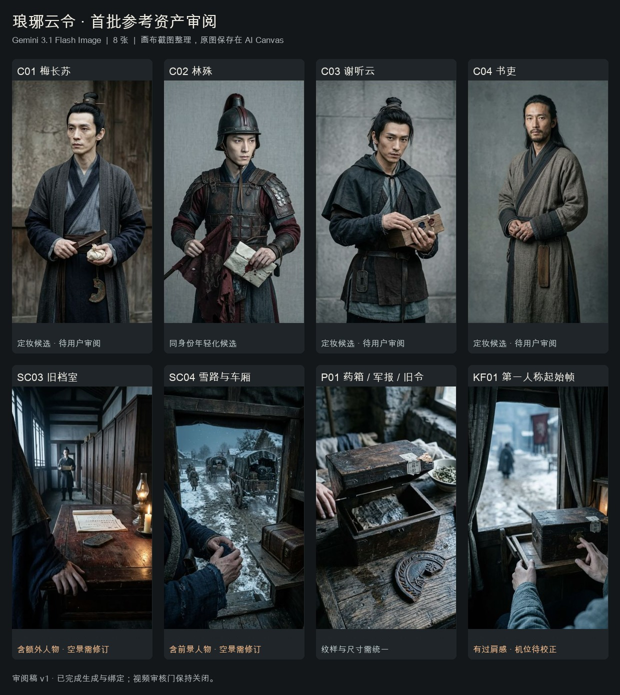

# 首批八图生成与人工检查

本次执行的是已确认的 **67 段分镜导入 + 8 张 Gemini 1k 参考图**。67 段分镜已应用，8 张图均完成并绑定回短剧资产库；没有重抽，没有启动视频。

审阅板由 AI Canvas 可见画面截图裁切整理，供比较角色与构图；原始媒体保存在制作画布和资产库中。

## 执行与输入核验

- 8 个独立图片生成请求，各自提交前报价 62 积分，提交预估合计 **496 积分**。
- 林殊任务回执确认使用 1 张参考图；起始帧回执确认使用 3 张参考图。两者任务中的实际提示词与记录稿哈希一致。
- 8 张图均为 768×1376。该原生尺寸接近 9:16；最终成片仍需安全裁切和统一规格，不能拉伸人物。
- 8 个画布运行均已收口，暂无活跃运行；视频审核字段仍为 `approved=false`。
- 短剧账单接口本次返回空消费记录，未归集这些画布节点消费，因此 **496 记为提交预估，不记为已核对的最终结算**。

## 人工检查结论

| 资产 | 观察 | 当前用途与处理 |
|---|---|---|
| C01 梅长苏 | 清瘦、灰青与墨蓝服装方向基本成立，手部和药包可读 | 定妆候选，待用户确认脸型、服饰与气质 |
| C02 林殊 | 年轻化及暗红军装成立；确实接收 C01 作为参考 | 同身份候选，需要与 C01 一起确认，不宣称已量化验证身份一致性 |
| C03 谢听云 | 深色便装、木匣及腰牌可读 | 定妆候选，待用户确认 |
| C04 书吏 | 服饰及腰牌成立，年龄观感偏成熟 | 定妆候选，年龄观感待用户确认 |
| SC03 旧档室 | 窗、柜、案的空间可读，但混入前景人体、远处人物及额外玻璃罩灯具 | **未满足纯场景参考要求**；暂只作空间和灯向草图，不能直接当干净背景板 |
| SC04 雪路与车厢 | 雪路和车队可读，但出现前景人物，前景药箱也与“接箱前为空”的起始状态不一致 | **未满足纯场景及起始状态要求**；暂只作空间/车队草图 |
| P01 药箱、军报、旧令 | 主体可读，箱盖与原页受潮状态清楚；旧令比例和纹样与角色腰佩仍需统一，封签已有生成字形 | 用于道具形制候选；锁定唯一尺寸、纹样，精确文字后期制作 |
| KF01 起始帧 | 已有两手、闭合药箱和雪路环境，但镜头偏右后方，画面有过肩感 | **暂不放行严格第一人称视频**；需用眼间中心机位校正构图，并检查铜扣和手指接触状态 |

生成完成与制作验收分开记录。本批是 **8/8 技术完成**，不是 8/8 画面通过；尚未形成最终定妆、最终场景或可直接出片的首帧。

## 提示词问题与修订方向

最初的共用前缀包含“原创演员面容”“皮肤纹理”“自己的手、袖口”“第三方在他面前活动”等人物描述，同时两个场景资产又要求“无人物”。这是本次提示词设计中应在提交前消除的冲突，已记录为失败案例；不能只把额外人物归咎于模型。

下一版把人物、纯空间、道具、叙事关键帧分开编写前缀。空景只保留材质、光线、空间和眼高观察点；关键帧才引入角色手部与袖口，并用灰模机位锁住相机原点。带越肩构图的场景草图不再作为关键帧的构图依据。

修订稿见 [参考图修订计划](REFERENCE-REPAIR-PLAN.md)。本轮没有提交修订生成；建议先完成灰模机位和角色选择，再决定是否需要新图。视频审核门保持关闭。
