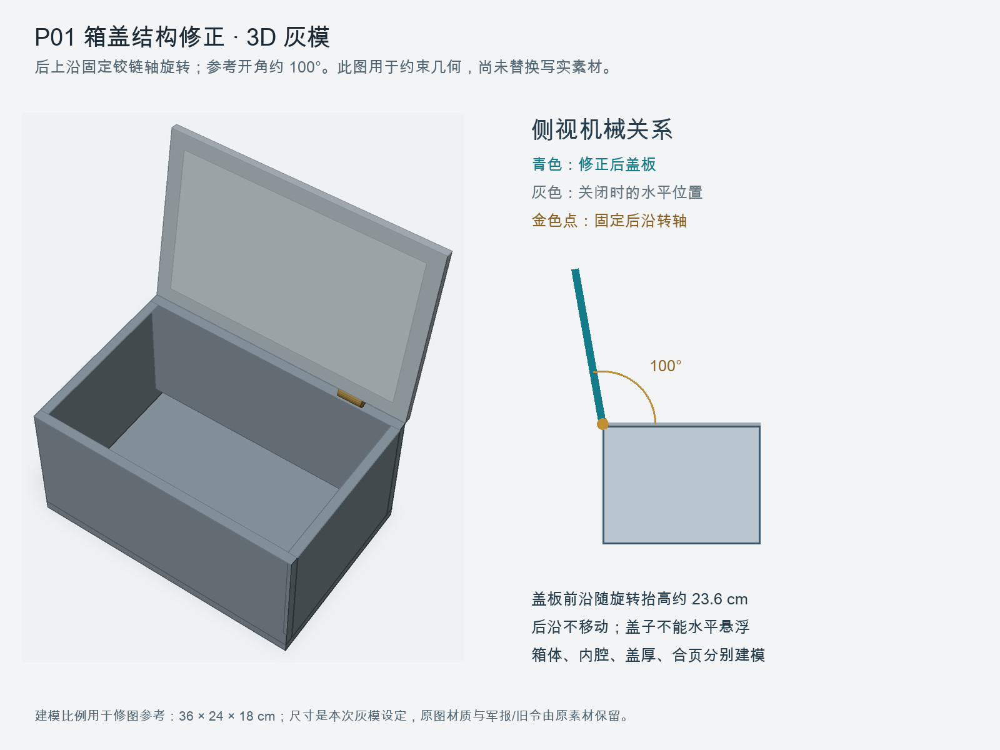

# P01 药箱盖几何修正 v2

用户复核指出 `07 P01 药箱 军报 旧令` 中开启的盖板仍近似水平、与箱体关系错误。初次人工检查遗漏了这一结构问题，本次将 P01 v1 标记为**箱盖几何不合格，仅留档**。

**只完成局部箱盖机构参考；原写实素材尚未替换，尚未发起新增图片生成。**

用户新增强制规则后，本修图必须先完成完整的“药箱—军报—旧令—案面—扶盖手—相机”3D包及人工审批；62积分费用确认本身不能放行。详见 [强制规范](../../docs/MANDATORY-3D-PRODUCTION.md)。

## 几何修正



- 箱盖后沿通过合页绕箱体后上沿的固定轴旋转。
- 开启角暂设约 100°；前沿抬高，盖板内侧与箱体内腔同时可见。
- 不把箱盖当作水平抬高的平板，也不让合页或后沿脱离箱体。
- 箱体由底板和四壁组成；盖板、厚度、内侧面和两个同轴合页分别建模。
- 灰模使用 36×24×18 cm 的工程比例；这是本次设计设定，不是对原图或历史药箱的实测值。写实修图保留原图箱体比例。

结构检查覆盖关闭姿态、90° 姿态、后沿固定、刚性尺寸保持、100° 时的高度差、内侧朝向，共 6 项。数值检查只验证几何参考，不能代替生成后对照片的检查。

## 已准备的单张修图

- 模型：继续使用 Gemini 3.1 Flash Image，1k、9:16。
- 输入 1：原始 P01 图片，只提供木纹、磨损、军报、旧令、药材、光线与原构图。
- 输入 2：[无标注几何参考](p01-lid-geometry-guide-v2.png)，只约束盖板与后沿铰链关系；不采用灰色材质或空箱状态。
- 修正目标：仅改开盖结构；若扶盖手势与新角度冲突，仅调整那只手的合理接触。
- [最终修图提示词](repair-prompt-v2.txt)已配置到 AI Canvas 独立修图节点。

实时单张报价 **62 积分**。该次修正不在此前已执行的 8 图、496 积分范围内；等待确认。独立修图授权字段为 false，视频审核字段也保持 false，当前整图跳过既有产物的报价为 0。

## 替换与验收

1. 先完成完整场景3D包并通过 `REPAIR:P01-v2` 预检，再在有效费用确认范围内执行这一张图，不重跑其他角色或场景。
2. 检查盖板是否绕真实后轴转起、是否仍与箱体相连、是否看得见盖板内侧和内腔，以及原军报和旧令是否保留。
3. 通过后把新图绑定回同一 P01 资产，保留 v1 版本和来源；同步更新 P01 当前参考版本及提示词。
4. 若照片仍不符合几何要求，保留失败结果并报告，不自动追加收费重抽。
5. 涉及开盖的镜头重新核对连续性；闭合起始帧仍需独立检查主观机位，不因 P01 修正而自动放行视频。

## 文件与复现

- [几何模型 OBJ](p01-open-lid-v2.obj)及[材质 MTL](p01-open-lid-v2.mtl)：实际三维网格，单位 cm。
- [几何参数与顶点](geometry.json)。
- [修图计划与画布节点](repair-plan.json)。
- [生成器](../../tools/p01_geometry.py)。
- [几何检查](../../tests/test_p01_geometry.py)。

从仓库根目录执行：

```bash
python3 -m unittest discover -s tests -p 'test_p01_geometry.py'
python3 tools/p01_geometry.py
```

测试使用 Python 标准库；生成 PNG 需要 Pillow 和本机可用的中文字体。图片、模型与提示词均已保存，便于直接审阅。
