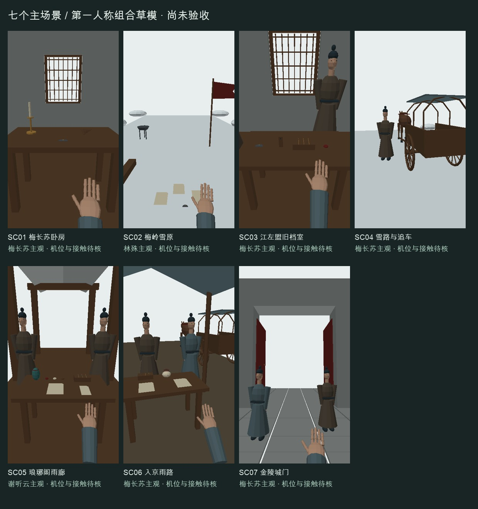

# 七个主场景组合草稿 v1

已导出七个主场景的代表性静态布景，共 157 个显式实例。组合模型读取仓库中实际 GLB 源文件，并保留其米制与作者坐标；人物、道路、建筑、车体和道具按资产 ID 复用。

完整子空间、手部接触、动物与马具动作、67 段分镜路径、全帧连续性和人工签核仍待完成。所有场景继续阻止生成。

| 场景 | 实例 | 组合模型 | 第一人称图 | 诊断图 |
|---|---:|---|---|---|
| SC01 梅长苏卧房 | 20 | [GLB](SC01/SC01.glb) | [主观图](SC01/SC01-pov.png) | [诊断图](SC01/SC01-diagnostic.png) |
| SC02 梅岭雪原 | 20 | [GLB](SC02/SC02.glb) | [主观图](SC02/SC02-pov.png) | [诊断图](SC02/SC02-diagnostic.png) |
| SC03 江左盟旧档室 | 23 | [GLB](SC03/SC03.glb) | [主观图](SC03/SC03-pov.png) | [诊断图](SC03/SC03-diagnostic.png) |
| SC04 雪路与追车 | 24 | [GLB](SC04/SC04.glb) | [主观图](SC04/SC04-pov.png) | [诊断图](SC04/SC04-diagnostic.png) |
| SC05 琅琊阁雨廊 | 26 | [GLB](SC05/SC05.glb) | [主观图](SC05/SC05-pov.png) | [诊断图](SC05/SC05-diagnostic.png) |
| SC06 入京雨路 | 28 | [GLB](SC06/SC06.glb) | [主观图](SC06/SC06-pov.png) | [诊断图](SC06/SC06-diagnostic.png) |
| SC07 金陵城门 | 16 | [GLB](SC07/SC07.glb) | [主观图](SC07/SC07-pov.png) | [诊断图](SC07/SC07-diagnostic.png) |



每个子目录还提供场景实例变换、主观相机、16 位毫米深度图、浮点深度、RGB 物体 ID 图及标签映射。PNG 深度背景为 0；浮点背景为正无穷。深度取相机前向距离。

## 重建与检查

从仓库根目录执行：

```bash
python3 -m tools.scene_blockouts
python3 -m tools.sync_asset_coverage
python3 -m unittest discover -s tests
python3 tools/geometry_preflight.py --scope ASSET:SC03
```

最后一条命令当前应返回阻塞：已有静态证据，但缺少实际几何审核报告和人工签核。重建或改变模型、相机、实例和渲染后，必须同步哈希，重新审核。

## 初轮验看与后续工作

- SC01：已调整手部入画位置；手压旧令、醒来坐起仍需单独动作和接触解算。
- SC02：三份军报、旧令、残旗已放入同一雪原坐标；雪坡、烽火效果和行进动作尚未制作。
- SC03：窗洞由墙段围合，未以完整实墙封死；已调整书吏位置，避免脸部与窗格重叠。柜内取卷、递交封签和转身动作仍待细化。
- SC04：追车空间包含马、车轮、车轴、车体、车篷和药箱；箱内军报需要额外的停靠近景，当前代表机位用于建立追车空间。缰绳连接、牵引与运动车轮仍待制作。
- SC05：雨廊中设置核验桌、两名信使、地图、锦囊、三色封泥、回执和云令匣；第三路信使、回报区、口播集合和雨效另需子布景。
- SC06：雨棚核验桌、卓青遥、萧景睿、车马共享道路空间；状纸与药包交接、坏轴替换、药童支援和临时封存动作尚未制作。
- SC07：城门保持实际门洞，两扇门按 90° 开启；灯架、人员与道路已定位，门下口播队形、提报动作和完整入城路径仍待制作。

人物只使用代理体块，面容与服饰不是最终形象。诊断图与轨道式三维浏览属于制作证据；成片所有镜头继续采用主人公第一人称。

当前使用有限的静态结构测试，并没有碰撞求解器或完整动画系统；不能由测试通过推导“所有几何无缺陷”。
